<p align="center">
  
</p>

<p align="center">
  <b>為 Google TV／Android TV 打造的主畫面：玻璃質感、跟著焦點流動的背景、內建農民曆，流暢第一。</b>
</p>

<p align="center">
  <a href="https://github.com/candy999/liuli-launcher/releases/latest">下載最新版</a> ·
  <a href="docs/releases/v1.1.2.md">1.1.2 版本說明</a> ·
  <a href="docs/ux-design.md">UX 設計</a> ·
  <a href="LICENSE">MIT 授權</a>
</p>

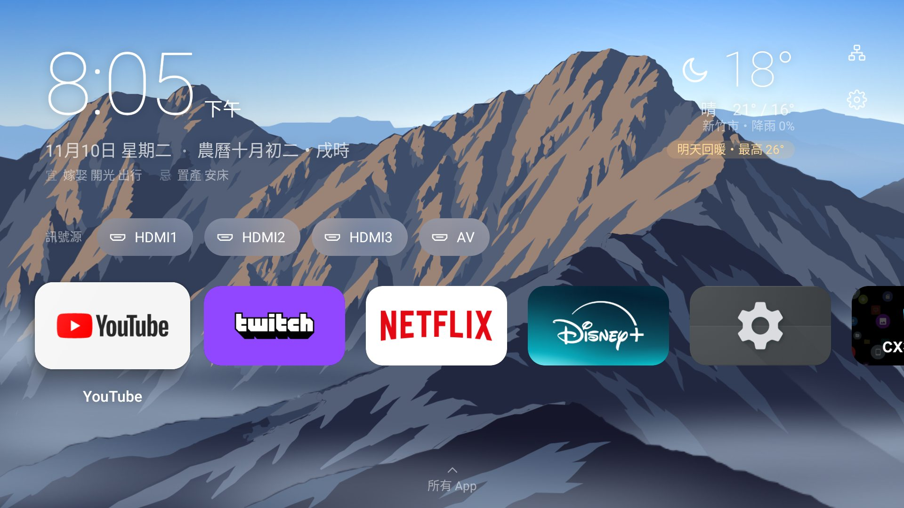

## 主畫面

- 左上：時間、日期、農曆、時辰、初一十五提示、今日宜忌
- 右上：天氣（現在溫度、今天高低溫與降雨機率、明天的提醒）；網路狀態（無線／有線／斷線）與設定
- 中間：訊號源（HDMI、AV…）；下方是常用 App，按下鍵展開所有 App
- 文字直接放在背景上，**選到時才浮出玻璃**；App 磚選到時放大、浮起、帶一道斜向光澤，名稱顯示在正下方
- 時鐘按確定開月曆、天氣按確定開天氣頁，返回鍵回到原本的位置

## 背景跟著焦點變色

選到哪個 App，背景就慢慢染成那個 App 的主題色。顏色變化有緩衝：停留一下才開始反應、平順過渡、不過衝，快速掃過也不會閃來閃去。

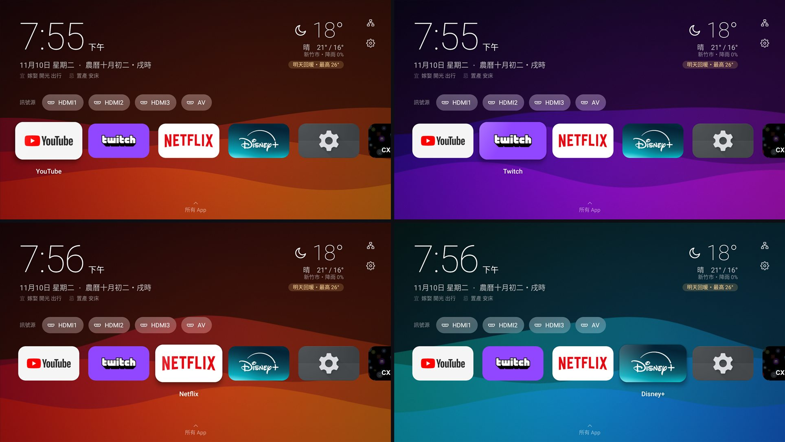

**設定 → 外觀 → 背景色系**：自動色彩（跟著焦點）開關；關閉時用二維色盤選固定顏色——左右是色相、上下是鮮豔度，背景即時預覽。

## 12 種背景樣式

**設定 → 外觀 → 背景樣式**，上下移動即時預覽，確定套用、返回取消。

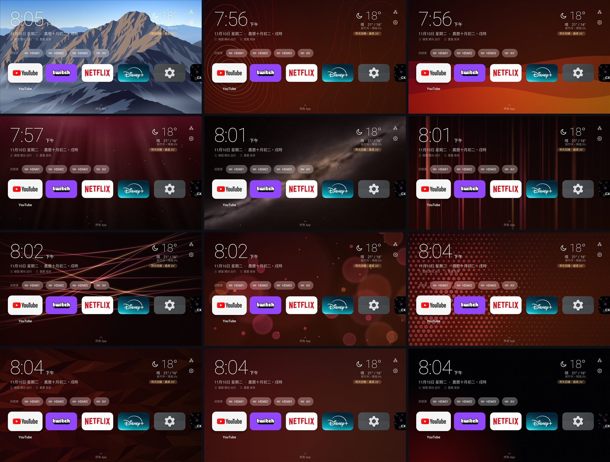

由左而右、由上而下：玉山星軌、等高線、流線浪潮、深海、星空銀河、光束、光軌、光斑、波點圓圈、幾何三角、純色、純黑（OLED）。

- **隨機**（預設）：每次啟動從勾選的樣式裡換一個，不會連續兩次一樣，用的時候不會突然換掉。在「隨機」裡逐一勾選要加入的樣式（按確定切換，至少留一個），第一列「使用隨機」套用
- **玉山星軌**：向量平塗的玉山（東峰、主峰、近稜……）分成七層，焦點移動時有前後視差
  - 山的亮面與天色跟著一天的太陽走：依玉山的太陽仰角分 12 個時段（深夜、黎明藍調、朝霞、日照金山、晨光、上午、正午、午後、黃金時刻、夕照、晚霞、暮色藍調），上午與傍晚各一套，季節不同日出日落時間自動跟著變
  - 暗面帶一點焦點 App 的色系，換 App 時跟著慢慢轉
  - 山谷間的霧由左往右流動，被前面的稜線擋住，像從山谷漫出來
  - 星軌整天繞著山後的南天極轉，白天只剩淡淡的痕跡，深夜是長曝光色調的同心圓星軌
  - 山與星軌以螢幕原生解析度顯示，焦點停下來就是最清楚的畫面
- **深海**：寬而柔的耶穌光從水面斜灑下來，光影晃動，海雪微粒飄落
- **星空銀河**：程序化生成的銀河星雲、近兩千顆一個像素的星點，亮星各自閃爍；漂移的星點靠近時連成星座網；偶爾劃過流星
- **光束**：粗細不一的垂直光束各自呼吸、緩慢飄移，往焦點聚攏
- **光斑**：照相機散景的景深關係——越近越大、越柔、越淡，焦點移動時移得越多

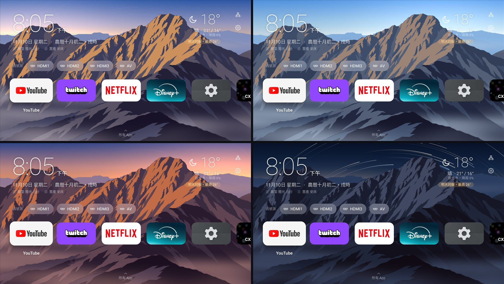

左上起：日照金山（06:20）、午後（15:00）、夕照（17:00）、深夜星軌（01:00）。

**設定 → 外觀 → 時光**：會隨時間變化的背景用「實時」，或「固定」在一個模擬時刻（左右鍵每次 10 分鐘，或直接選深夜、黎明、日出、早晨、正午、午後、夕陽、暮色）。

| 背景樣式的隨機範圍 | 時光 |
|---|---|
| 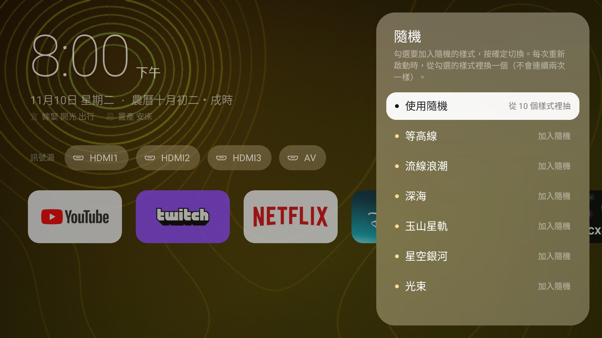 | 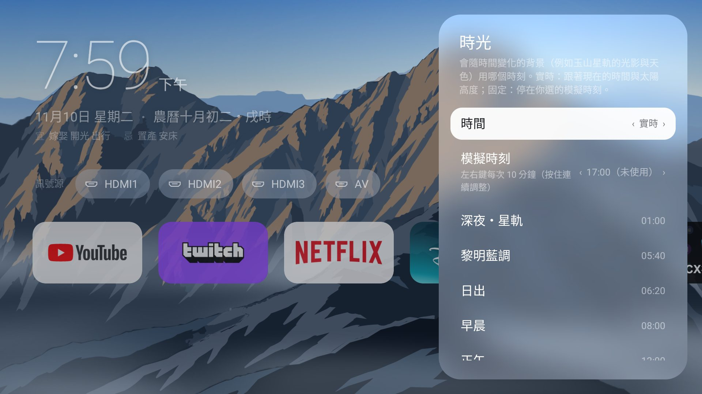 |

## 兩種主畫面模式

**設定 → 主畫面模式**（左右鍵或確定鍵切換）：

- **正常人模式**（預設）：乾淨的主畫面
- **技術宅模式**：多兩樣東西
  - **火箭**（齒輪正下方）：一鍵結束所有背景程式（不動前景與琉璃自己），畫面正中央顯示 3 秒：記憶體環形圖從清理前縮到清理後、釋放多少 MB、可用記憶體前後對照
  - **系統儀表列**（常用列下方，五張玻璃卡，每秒更新，不拿焦點）
    - CPU：晶片型號與核心、使用率、各核心、目前頻率、最近 60 秒折線（整體使用率透過已授權的無線偵錯讀取；沒授權時用頻率估計並標示「頻率負載」）
    - GPU：型號（例如 Mali-470 MP、PowerVR Rogue）、使用率（驅動有開放時）、琉璃的 fps、每幀時間與背景更新率
    - 記憶體：已用／可用／總量、環形圖
    - 網路：Wi-Fi（頻段、訊號、連線速率）／有線網路／未連線（斷線多久）；到路由器與到網際網路的延遲、抖動、上下行流量
    - 系統：電視品牌與型號、Android 版本、開機時間、IP、儲存空間
  - 只用白色的透明度層次；出狀況的卡片數字（以及核心條、環形圖）變暖金

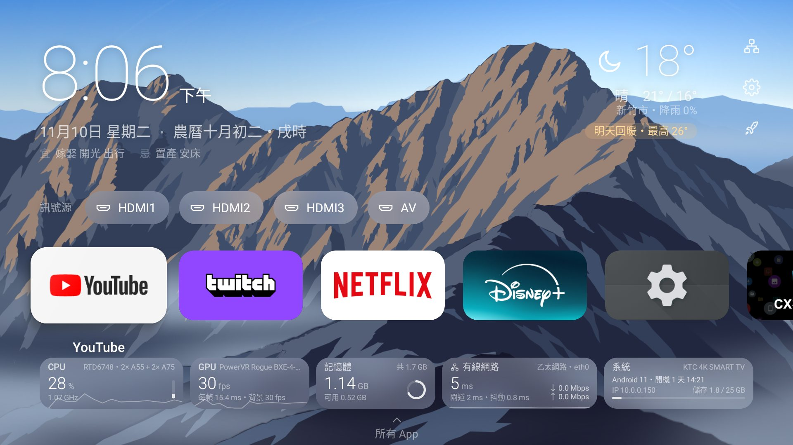

| 火箭清理結果 | 簡潔模式 |
|---|---|
| 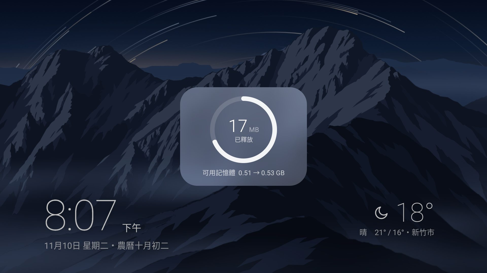 | 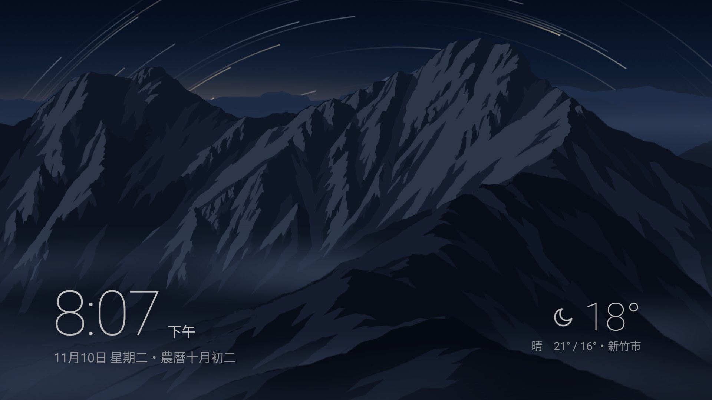 |

## 簡潔模式

在主畫面最上方再按一次上鍵，其他介面往下收起，只留左下角的時間日期、右下角的天氣；按任何方向鍵或確定鍵拉回來。簡潔模式中背景的焦點位置像老 DVD 待機畫面一樣慢慢斜著走、碰到邊緣反彈並換一個顏色，背景一直平順地流動。

**設定 → 外觀 → 簡潔模式**：

- 閒置自動進入：關、15 秒～5 分鐘（預設 1 分鐘）
- 微光（關／輕／中／深）：整個畫面壓暗，同時請系統調低螢幕亮度，省電、保護面板
- 微飄移：時間與天氣緩慢飄動，避免烙印
- 自動清理記憶體：進入時結束所有背景程式，畫面正中央顯示 3 秒結果
- 現在進入簡潔模式

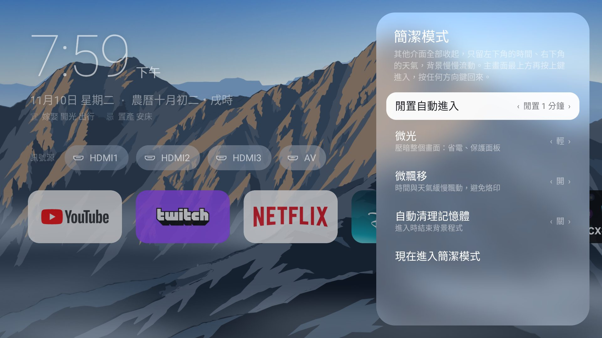

## 背景質感與邊框

- **背景模糊**（6 級）：模糊越強越省效能——背景改畫在很小的圖上再模糊，GPU 只放大一張圖
- **抖色**（永遠開啟）：所有漸層在量化成 8 bit 之前加入不到一階的噪點，暗色大面積漸層不會一圈一圈斷開
- **細緻噪點**（關／極細／細／中）：原生解析度的細顆粒，打散殘餘的色帶
- **邊框**：黑框粗細、圓角半徑、往內漸變範圍；只蓋背景與左右捲動的列，不會遮住時鐘、天氣

## 液態玻璃

不用框線、不用高光邊，邊緣靠光：玻璃取用背景的高斯模糊，加上過曝與提高飽和度。模糊在背景執行緒計算，不佔用畫面的主執行緒；Android 13 以上再加邊緣透鏡折射。

## 設定

| 設定首頁 | 外觀 |
|---|---|
| 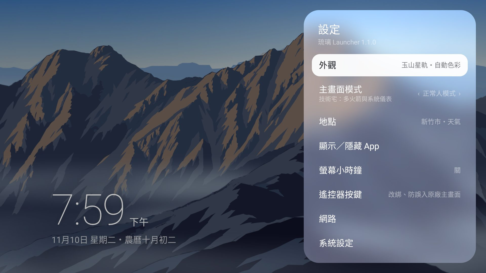 | 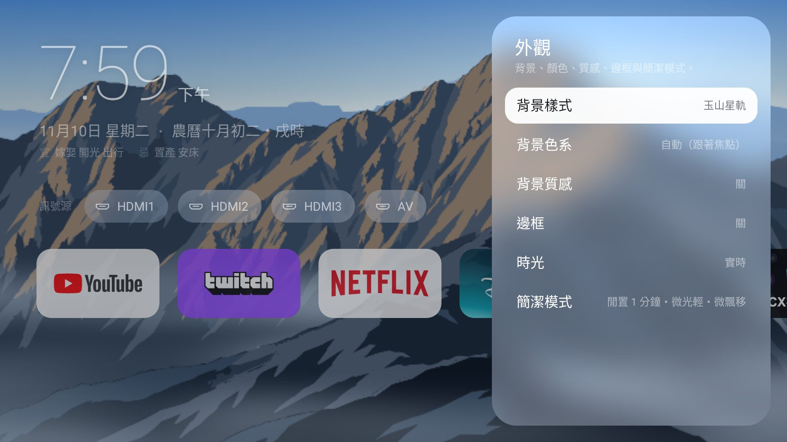 |

- 設定首頁：外觀、主畫面模式、地點、顯示／隱藏 App、螢幕小時鐘、遙控器按鍵、網路、系統設定、進階、關於琉璃
- 返回鍵一律回到上一層，焦點停在剛才進去的那一項
- 右邊有「‹ 值 ›」的項目：左右鍵調整，確定鍵換到下一個值，選單不會關掉
- **關於琉璃**：版本、專案網址的 QR code、手動檢查更新。只看正式發布的版本，不會自動檢查或安裝；有新版時按「安裝新版本」才交給系統安裝

## 冷啟動

開機或第一次開啟時背景先全黑，CPU 與 GPU 留給介面載入；等焦點落到第一個 App、而且這個樣式要用的資源都準備好，背景才從那個 App 的位置、以那個 App 的顏色往外擴散。離開琉璃時會釋放背景資源，回來時先蓋黑、載入好再淡出。

## 農民曆與月曆

| 月曆 | 天氣 |
|---|---|
| 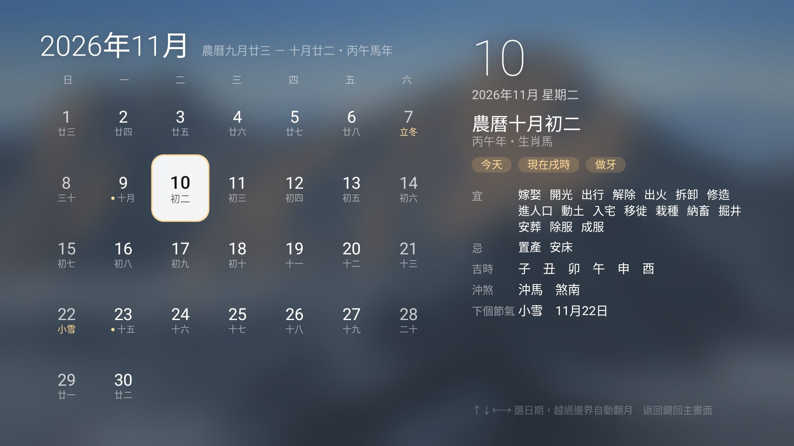 | 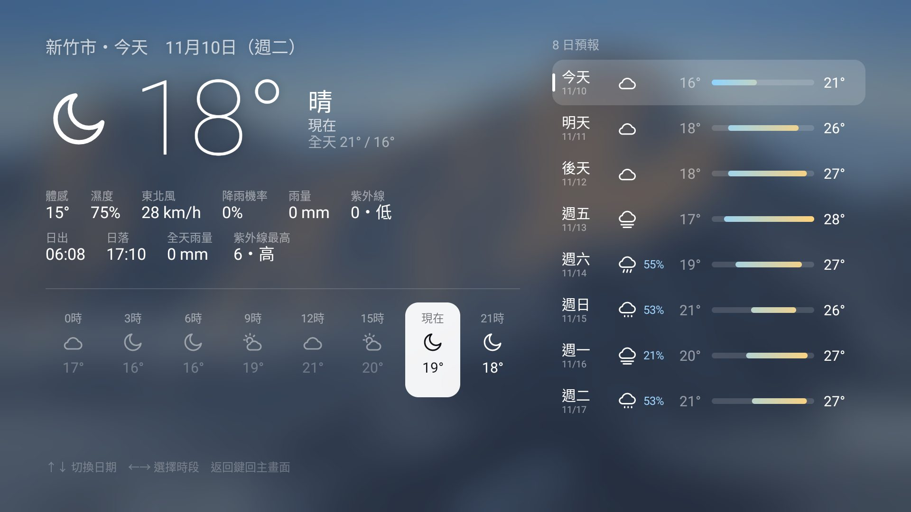 |

- 農曆日期、干支生肖、節氣、宜忌、沖煞、**吉時**，主畫面顯示**目前時辰**，全部離線計算（[lunar-java](https://github.com/6tail/lunar-java)）
- **農曆以子時換日**：晚上 11 點起，宜忌與初一十五提示就算下一天
- 全部用字**正體中文**（1901～2099 每一天都稽核過）；閏月顯示為「閏」
- 宜忌依字數自動選字級，最長的一天也完整顯示
- 台灣節日 30 多個，初一十五以暖金色標示
- 月曆用方向鍵選日期，越過月份邊界自動翻月；農曆小字與右側詳情在背景計算，不卡方向鍵

## 天氣

[Open-Meteo](https://open-meteo.com/)，免金鑰。地點在**設定 → 地點**選縣市，只用縣市中心座標，不讀取裝置定位。

- 主畫面右上：現在的溫度與天氣、今天的高低溫與降雨機率，再加一句**明天**的提醒——只講會改變決定的一件事：會下雨（哪個時段）、雨停、明顯轉涼或回暖、紫外線過量，或「明天和今天差不多」
- 天氣頁：上下鍵切換日期（今天～7 天後），左右鍵選擇時段（每 3 小時一段）；左邊是該時段的溫度、體感、濕度、風、降雨、紫外線與日出日落，右邊是 8 日預報

## App 管理

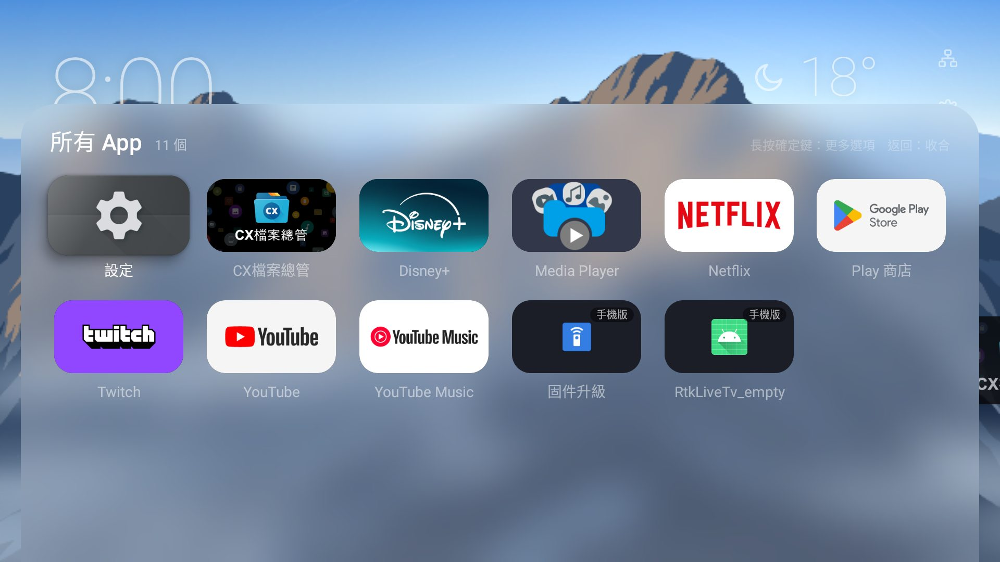

- **常用 App**：在所有 App 長按 → 加入常用；在常用列長按 → 移動位置（左右移動、確定放下、返回取消）或從常用移除
- **顯示／隱藏 App**：原廠主畫面不列出的手機版 App 也會出現（標示「手機版」），可以自己決定顯示或隱藏
- 長按選單也有應用程式資訊（強制停止、清除快取）與解除安裝

## 螢幕小時鐘

看其他 App 時，角落仍然看得到時間（設定 → 螢幕小時鐘）：位置、文字大小、位移、只有陰影或半透明底；回到琉璃主畫面自動隱藏；跟隨系統的 12／24 小時制；每分鐘微移幾個像素防烙印。

## 遙控器按鍵與主畫面保護

- **改綁按鍵**：任何按鍵的「按一下」或「按住半秒」都可以改成開某個 App、指定訊號源、音量、媒體播放、琉璃功能（主畫面、所有 App、月曆、天氣、螢幕小時鐘）、系統功能，或停用這顆鍵
  - 設定 → 遙控器按鍵 → 新增綁定 → 按一下要改的鍵 → 選「按一下」或「按住半秒」→ 選功能；已綁定的按鍵可以修改或刪除
  - **按鍵測試**：顯示琉璃收到了什麼鍵（有些品牌鍵由電視系統直接處理，琉璃收不到）
- **受保護的基本鍵**：方向、確定、返回、Home、音量、電源不能被改綁
- **主畫面保護**：原廠主畫面跳出來時自動切回琉璃
- **不用電腦也能開啟**：琉璃內建網路 ADB 用戶端，可以對自己下指令開啟按鍵服務

按鍵服務只做三件事：攔截按鍵、取得前景 App 的套件名稱（偵測原廠主畫面）、顯示螢幕小時鐘。不讀取畫面內容，也不連網。

## 流暢度

在入門電視上調校：AOC（Realtek RTD6748、PowerVR BXE-4-32）與海信 A4（MediaTek M7322、Mali-470、OpenGL ES 2.0、Android 9）。

- **靜止時零耗電**：背景追上目標就停止重畫
- **操作優先**：按鍵後一小段時間，背景改用省力模式（解析度降低、更新率至少每秒 20 格），GPU 留給焦點動畫與捲動
- **自適應畫質**：背景解析度＝原生 ÷1～÷5，依每一幀的實際耗時自動升降；降解析度沒用的樣式改降更新率（30／20／15fps）；停止前提前升到最清楚的檔位
- **分層解析度**：玉山星軌的山與星軌用原生解析度、天空與霧用低解析度；山畫成快取，顏色在合成時才套用，焦點停下來每格只貼一張圖
- **效能最佳化**（設定 → 進階）：透過本機網路 ADB 把琉璃預先編譯成機器碼，第一次操作就順

## 安裝

1. 下載 [Releases](https://github.com/candy999/liuli-launcher/releases/latest) 上的 APK。
2. 安裝到電視，二擇一：
   - **用電腦 ADB**：
     ```bash
     adb connect <電視IP>:5555
     ```
     ```bash
     adb install -r LiuliLauncher-1.1.2.apk
     ```
   - **不用電腦**：在電視上裝 Downloader，輸入 Release 頁面上的 APK 網址。
3. 設為預設主畫面：**設定 → 預設主畫面**。很多 Google TV 沒有這個選項，可以改用以下任一方式：
   - 開啟**主畫面保護**（設定 → 遙控器按鍵），按 Home 鍵就會回到琉璃。
   - 用 ADB **停用**原廠主畫面（不是刪除，隨時可以還原）：
     ```bash
     adb shell pm disable-user --user 0 com.google.android.apps.tv.launcherx
     ```
     還原：
     ```bash
     adb shell pm enable com.google.android.apps.tv.launcherx
     ```

### 開啟遙控器按鍵服務

**設定 → 遙控器按鍵 → 啟用按鍵服務**：琉璃會透過電視的網路 ADB 自己開啟服務，電視第一次會跳出「允許 USB 偵錯」，選允許即可（需要先在開發人員選項開啟網路偵錯）。也可以用電腦：

```bash
adb shell settings put secure enabled_accessibility_services tw.liuli.launcher/.keys.KeyRemapService
```

## 從原始碼建置（不用安裝開發環境）

Fork 這個 repo，**Actions** 會自動用雲端機器編出 APK：

- 每次推到 `main`：更新「nightly」預覽版，固定網址 `https://github.com/candy999/liuli-launcher/releases/download/nightly/LiuliLauncher-nightly.apk`
- 推 `v` 開頭的 tag（例如 `v1.1.0`）：發布正式版，版本號取自 tag，說明取自 `docs/releases/<tag>.md`

想用自己的簽章（之後的版本才能直接覆蓋更新）：

```bash
pip install cryptography
```

```bash
python tools/make_keystore.py
```

照畫面上的說明，把四個 Secret 填進 repo 的 **Settings → Secrets and variables → Actions**。金鑰要好好保存，弄丟就無法覆蓋更新已安裝的 App。

## 專案結構

```
app/src/main/java/tw/liuli/launcher/
├── MainActivity.kt          進入點、頁面切換（主畫面／月曆／天氣）、Home 鍵
├── adb/                     內建網路 ADB 用戶端
├── context/                 農民曆、台灣節日、天氣
├── data/                    App 清單與主題色、常用列、隱藏清單、訊號源
├── geek/                    技術宅模式：系統資訊取樣、火箭
├── keys/                    無障礙按鍵服務、按鍵對應、螢幕小時鐘
├── settings/                啟動器設定
├── system/                  系統設定捷徑
└── ui/
    ├── bg/                  背景引擎（緩衝、自適應畫質、時光）、12 種樣式、玉山向量資料
    ├── glass/               液態玻璃材質
    ├── components/          焦點、App 磚、側邊面板
    ├── home/                主畫面、所有 App、技術宅儀表列、邊框
    ├── calendar/            月曆＋農民曆
    ├── weather/             天氣預報
    └── theme/               顏色、字體、圖示
design/                      HTML 原型（用瀏覽器開啟）
docs/                        UX 設計、版本說明、截圖、Logo
tools/                       簽章金鑰、Logo 產生器、玉山向量處理
```

## 隱私

不需要任何帳號；不讀取裝置定位（天氣只用你選的縣市中心座標）；按鍵服務不讀取畫面內容、不連網。網路連線只有：向 Open-Meteo 取得天氣；技術宅模式量網路延遲時連到你的路由器與 1.1.1.1（只建立連線、不傳資料）；你按「檢查更新」時向 GitHub 查詢正式版。

## 授權

[MIT](LICENSE)。使用到的開源專案：[lunar-java](https://github.com/6tail/lunar-java)（MIT）、AndroidX／Jetpack Compose（Apache-2.0）；天氣資料來自 [Open-Meteo](https://open-meteo.com/)（CC BY 4.0）；字標使用 [Noto Sans TC](https://fonts.google.com/noto/specimen/Noto+Sans+TC)（OFL）轉成輪廓。
