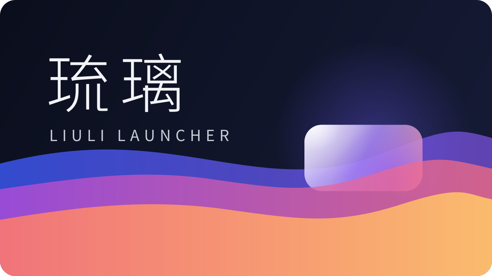
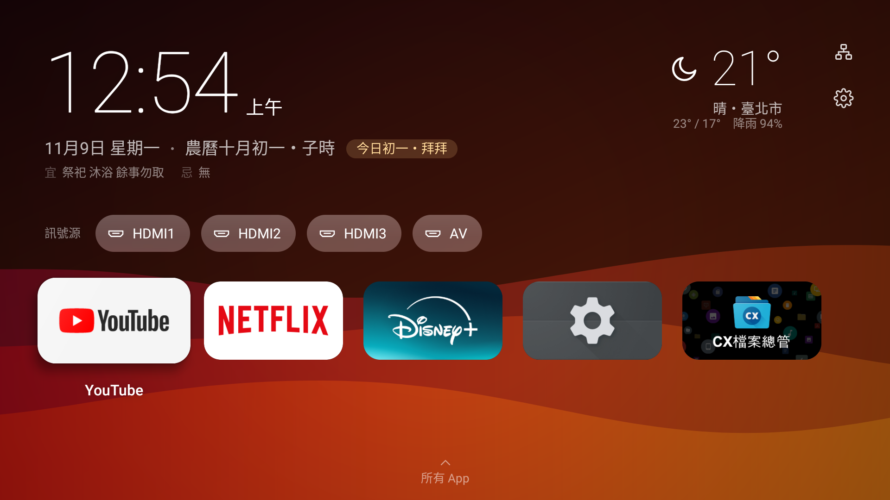
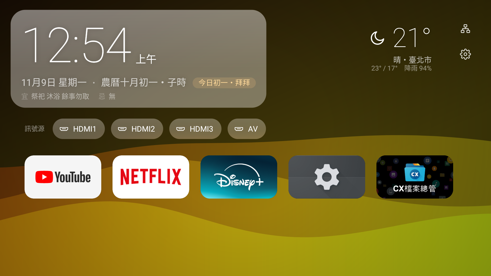
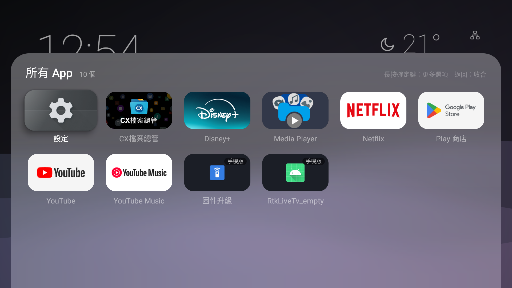
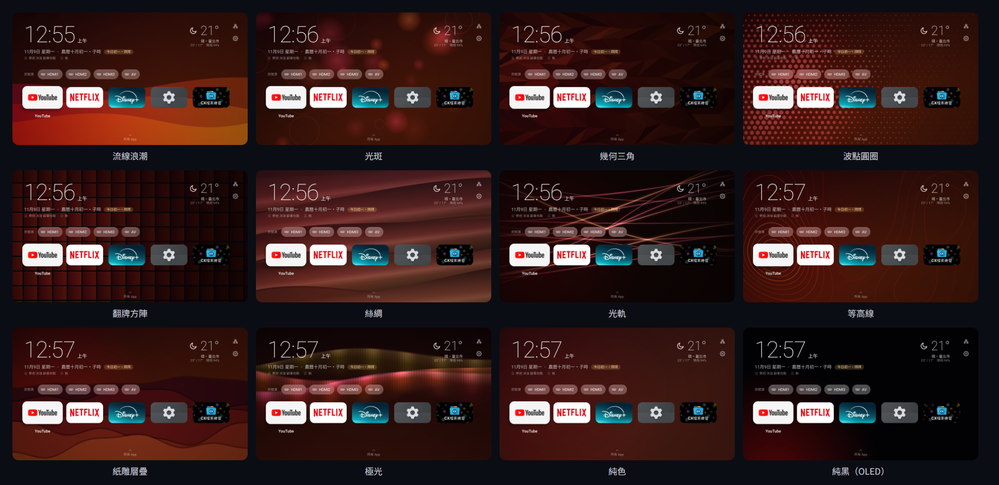
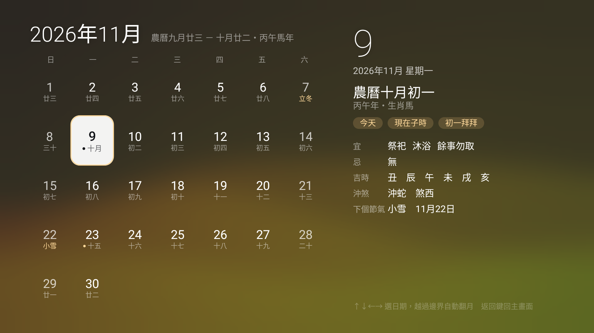
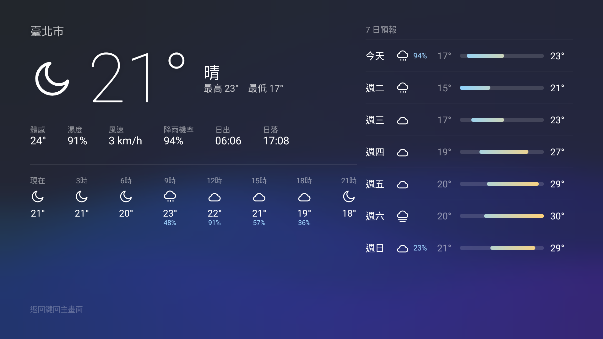
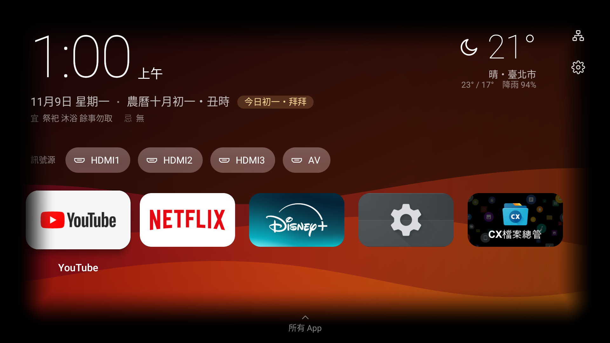
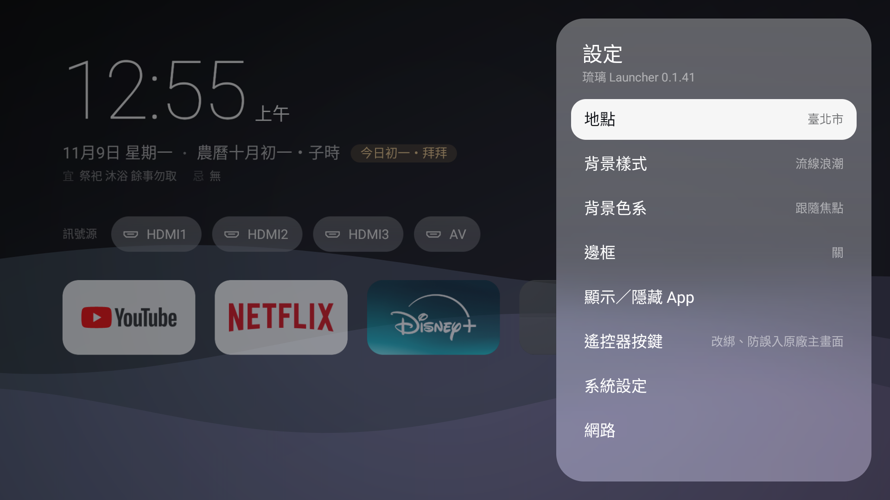
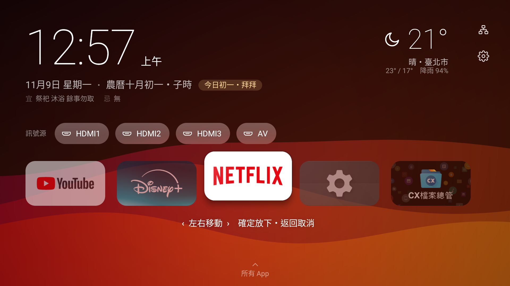

<p align="center">
  
</p>

<p align="center">
  <b>為 Google TV／Android TV 打造的主畫面：玻璃質感、跟著焦點流動的背景、內建農民曆，流暢第一。</b>
</p>

<p align="center">
  <a href="https://github.com/candy999/liuli-launcher/releases/latest">下載 1.0.0 穩定版</a> ·
  <a href="docs/releases/v1.0.0.md">版本說明</a> ·
  <a href="docs/ux-design.md">UX 設計</a> ·
  <a href="LICENSE">MIT 授權</a>
</p>



> **1.0.0 是第一個穩定版。** 已在 AOC 4K 電視（Realtek RTD6748、Android 11、1.7 GB RAM）上完整驗收，也在 MEmu 模擬器（Android 9）上測過。其他機型歡迎[回報問題](https://github.com/candy999/liuli-launcher/issues)。

## 特色

### 主畫面

時間、日期、農曆、時辰、初一十五提示、今日宜忌放在左上；天氣在右上；網路狀態（無線／有線／斷線）與設定在右上角。中間是訊號源，下面是常用 App，按下鍵展開所有 App。

- 文字直接放在背景上，**只有選到的時候才浮出玻璃**；App 磚不加框，選到時放大、浮起、帶一道斜向光澤（tvOS 的做法）
- 時鐘按確定開月曆、天氣按確定開天氣頁，返回鍵回到原本的位置

| 時鐘被選到（浮出玻璃） | 所有 App |
|---|---|
|  |  |

### 跟著焦點流動的背景

選到哪個 App，背景就慢慢染成那個 App 的主題色。顏色與形狀的變化經過「電容式」緩衝：停留 0.18 秒才開始反應、兩級 RC 平滑、不過衝，快速掃過也不會閃來閃去；連續按著方向時最多 0.45 秒跟一次。

**設定 → 外觀 → 背景色系**：自動色彩（跟著焦點）開關；關閉時用二維色盤選固定顏色——左右是色相、上下是鮮豔度，背景即時預覽，確定完成、返回還原。

12 種向量背景（設定 → 背景樣式，上下移動即時預覽）。第一個選項是**隨機**（預設）：每次冷啟動、背景從黑畫面載入時抽一個樣式（不含純色、純黑，也不和上次重複），用的時候不會突然換掉。順序依意象相近排列（線條 → 海 → 山 → 星空 → 光 → 幾何 → 純色）。其中四種一直在動（深海、山稜、星空銀河、光束），用一個「只在背景真的有畫時才前進」的時鐘，面板滑動或離開琉璃時暫停、回來接著動：

- **光斑**：照相機散景的物理關係——越近越大、越柔、越淡、焦點移動時移得越多；數量偏向遠方，再錯落幾個極大極淡的光暈
- **星空銀河**：銀河的星雲是程序化生成的貼圖（碎形雜訊的雲團、雜訊挖出的彎曲暗塵帶、核心偏暖外圍偏冷，生成後暈開，只在第一次用時於背景執行緒算約 0.2 秒），再疊上近兩千顆原生解析度、約一個像素的星點；滿天的星大多只有一個像素，少數亮星帶細小柔光、各自閃爍；一群緩慢漂移的星點彼此靠近時連出細線、遠離時淡去，星座網一直在重組；偶爾劃過流星
- **深海**：上方透光往下漸暗；寬而模糊、錯落重疊的耶穌光從水面斜灑下來（橫向縱向都柔和漸淡，沒有邊界），光斑與陰影緩慢晃動，海雪微粒飄落
- **山稜**：向量平塗的玉山（東峰、主峰、近稜……）。山是使用者轉好的向量圖（SVG，10 個平塗色），依手繪的稜線分成 7 層，層的交界吸附在向量色塊的邊上；每層有完整的底色剪影，被擋住的那一圈延續這一層的色塊顏色，焦點移動時整層平移，前景移開露出的是後面山坡的延續。山的亮面與天色跟著一天的時間走，暗面帶一點焦點 App 的色系（換 App 時跟著慢慢轉）：依玉山的太陽仰角分 12 個時段（深夜、黎明藍調、朝霞、日照金山、晨光、上午、正午、午後、黃金時刻、夕照、晚霞、暮色藍調），上午與傍晚各一套、平順過渡，季節不同日出日落時間自動跟著變；**設定 → 外觀 → 時光**可選「實時」或「固定」在一個模擬時刻（左右鍵每次 10 分鐘，或直接選日出、正午、夕陽、深夜等），這是全域參數，之後其他會隨時間變化的樣式也用它。雲是平塗的雲頭，風由左往右吹，濃淡隨風穿過山脈；深夜是長曝光色調與繞著山後南天極旋轉的同心圓星軌
- **光束**：粗細不一的垂直光束各自呼吸、緩慢飄移，往焦點聚攏、焦點附近較亮



### 液態玻璃

不用框線、不用高光邊，邊緣靠光：玻璃取用背景的**高斯模糊**（三次盒狀模糊）再加上**過曝**與提高飽和度。模糊在背景執行緒計算，不佔用畫面的主執行緒；Android 13 以上再加邊緣透鏡折射。

### 背景質感：模糊、抖色與細緻噪點

設定 → 背景質感（左右鍵即時調整）：

- **背景模糊**（6 級，σ 8～48 像素）：模糊越強反而**越省效能**。背景改在背景執行緒畫成很小的圖、在小圖上模糊，GPU 只放大一張圖，向量完全不上 GPU。
  能縮多小有實驗依據：小圖上的模糊量 ≥ 2 個小圖像素時，和原生解析度高斯模糊的差異 ≤ 3／255，看不出來、也不會有鋸齒（[實驗紀錄](docs/blur-shortcut.md)）。
- **抖色**（永遠開啟，不用設定）：8 bit 面板一個通道只有 256 階，暗色的大面積漸層一階會橫跨上百個像素（海信實測：極光暗部同一個值連續 80～130 像素），看起來一圈一圈。
  所有漸層在**量化成 8 bit 之前**，每個通道各自加入不到一階的噪點（GPU 著色器裡把漸層與一張噪點貼圖以浮點相加，寫入畫面時才取整數；Android 9 上只開 Paint 的抖色旗標實測沒有作用）：介於兩階之間的顏色依比例交錯成相鄰兩階，平均起來就是正確的中間色。不是疊一層圖上去，噪點只有 ±½ 階、看不見。CPU 算的背景模糊在最後一步也做同樣的處理。
  噪點在實體螢幕上固定 2 像素一格（背景切換解析度時顆粒大小不變），並跟著焦點做平滑的小數像素視差位移，和背景一起滑動，不像固定在螢幕上的紗窗；模糊模式的噪點圖樣固定，不會每張重新亂數而閃爍。
  海信實測：極光暗部同一個值連續的長度從 90 像素降到 2 像素（[前後對比](docs/dither-compare.png)，色差放大 8 倍）。
- **細緻噪點**（關／極細／細／中＝1～3 階）：以原生解析度、每個通道各自加上數學產生的三角分佈噪點（加法混合，不改色相、不起霧），把背景放大時殘餘的細小階梯打散。每幀只多一個貼圖四邊形。

### 簡潔模式

在主畫面最上方（時鐘、天氣、設定那一排）再按一次上鍵，其他介面全部往下收起，只留左下角的時間與日期、右下角的天氣，畫面最乾淨；按任何方向鍵或確定鍵就拉回來。簡潔模式中沒有選中的項目：一個看不見的點像老 DVD 待機畫面的標誌一樣，以很慢的等速斜著走、碰到邊緣就反彈（橫越一次約 25 秒），背景的焦點位置跟著它一直平順地流動，每次撞到邊緣換一個顏色（選了固定顏色時只流動不換色）；回來時還原成原本焦點項目的顏色與位置。**設定 → 外觀 → 簡潔模式**：
  - 閒置自動進入：關、15 秒～5 分鐘（預設 1 分鐘）
  - 微光（關／輕／中／深，預設「輕」）：整個畫面壓暗，同時請系統調低螢幕亮度（電視支援時能省電），保護面板
  - 微飄移（預設開）：時間與天氣各自以一兩分鐘的週期緩慢飄動 ±24 dp，避免烙印
  - 現在進入簡潔模式

### 設定選單的操作

- 設定首頁：外觀、地點、顯示／隱藏 App、螢幕小時鐘、遙控器按鍵、網路、系統設定、進階（效能最佳化、預設主畫面、重新整理 App 清單）、關於琉璃
- 和畫面呈現有關的設定收在**設定 → 外觀**（背景樣式、背景色系、背景質感、邊框、簡潔模式）
- **關於琉璃**：版本、專案網址的 QR code（手機掃描打開 GitHub 頁面）、手動檢查更新。只看正式發布的版本，不會自動檢查或安裝；按「檢查更新」才下載比對（比的是內部版本碼，預覽版 0.1.x 不會被誤判成比正式版 1.0.0 舊），有新版時再按「安裝新版本」才交給系統安裝（系統還會再確認一次）
- 出場語言一致：面板與抽屜先滑出玻璃底框與標題，幾乎到位時清單一列一列（App 一排一排）淡入浮上；冷啟動時常用列等 App 清單確認載入後才出現（不會先閃出「加入常用」），一個一個淡入浮上
- 返回鍵一律回到上一層，焦點停在剛才進去的那一項；選完一個選項（例如地點、背景樣式）也是套用後回到上一層
- 右邊有「‹ 值 ›」的項目：左右鍵調整，確定鍵換到下一個值（開關、選項會輪巡），選單不會關掉

### 冷啟動

開機或第一次開啟時背景先全黑、完全不畫，CPU 與 GPU 留給介面載入；焦點落到第一個 App 時（App 清單載入前焦點停在時鐘上不算），背景才從那個 App 的位置、以那個 App 的顏色往外擴散（約 1.4 秒），同時盪出一圈漣漪。等 4 秒仍沒有焦點時從畫面中央開始。

### 農民曆與月曆

| 月曆（宜忌最多的日子也放得下） | 天氣 |
|---|---|
|  |  |

- 農曆日期、干支生肖、節氣、宜忌、沖煞、**吉時**，主畫面顯示**目前時辰**，全部離線計算（[lunar-java](https://github.com/6tail/lunar-java)）
- **農曆以子時換日**：晚上 11 點起，宜忌與初一十五提示就算下一天（國曆節日仍照國曆）
- 全部用字**正體中文**：1901～2099 每一天的宜忌、月份、節氣、生肖、沖煞、時辰都稽核過，沒有殘留簡體字；閏月正確顯示為「閏」
- 宜忌以詞為單位換行、依字數自動選字級：最長的一天（宜 31 項、合計 107 字）也完整顯示
- 台灣節日 30 多個（春節、元宵、清明、端午、中元、中秋、冬至、尾牙、除夕…），初一十五以暖金色標示
- 月曆用方向鍵選日期，越過月份邊界自動翻月
- 月曆不用等農民曆：日期格子立刻畫出，農曆小字算好再淡入；右側詳情在背景計算（不卡方向鍵），算過的日子會記住，前後兩個月也預先算好
- 月曆、天氣的進出有先後：進入時主畫面先加速淡出，子頁面再從下方浮上淡入；離開時子頁面先淡出，完全消失後主畫面才淡入。過場期間背景暫停

### 天氣

[Open-Meteo](https://open-meteo.com/)，免金鑰。地點在**設定 → 地點**選縣市，只用縣市中心座標，不讀取裝置定位。

- 主畫面右上：現在的溫度與天氣、今天的高低溫與降雨機率，再加一句**明天**的提醒。看明天天氣是為了決定要不要帶傘、要不要加衣服，所以只講跟今天比會改變決定的一件事，依序：會下雨（哪個時段，例如「明天下午可能下雨 70%」）→ 今天下雨、明天雨停 → 溫度明顯變化（「明天轉涼，最高 20°（低 4°）」、「明早較冷，最低 13°」）→ 紫外線過量 → 「明天和今天差不多」。
- 天氣頁：**上下鍵**切換日期（今天～7 天後），**左右鍵**選擇時段（每 3 小時一段），左邊顯示該時段的詳細天氣——溫度、體感、濕度、風向風速、降雨機率、雨量、紫外線，以及當天的日出日落、全天雨量；右邊 8 日預報標出目前選的那一天。今天預設選「現在」，換到其他天時保持同一個時段。

### 邊框

設定 → 邊框：黑框粗細、圓角半徑、往內漸變範圍（左右鍵即時調整；粗細 0 dp＝只要圓角）。黑框蓋在背景與左右捲動的列上，**不會遮住**時鐘、天氣等固定介面，所有 App 與設定面板則蓋在黑框上面。黑框永遠以原生解析度繪製。

| 邊框 24 dp・圓角 48 dp・漸變 64 dp | 設定面板 |
|---|---|
|  |  |

### App 管理

- **常用 App**：在所有 App 長按 → 加入常用；在常用列長按 → **移動位置**（抓住後左右移動、確定放下、返回取消）或從常用移除。常用全部移除後會出現「＋ 加入常用」磚，不會卡住
- **顯示／隱藏 App**：原廠主畫面不列出的手機版 App 也會出現（標示「手機版」），可以自己決定顯示或隱藏
- 長按選單也有應用程式資訊（強制停止、清除快取）與解除安裝



### 螢幕小時鐘

看 Netflix、YouTube 等其他 App 時，角落仍然看得到時間（設定 → 螢幕小時鐘）：

- 位置：左上、右上、左下、右下；文字大小 12～72 sp；從角落往內的水平／垂直位移（每次 4 dp）
- 背景：只有陰影，或半透明底（亮的畫面上也讀得到）
- 回到琉璃主畫面自動隱藏（主畫面本來就有大時鐘）；調整時主畫面上也會顯示，方便即時預覽
- 跟隨系統的 12／24 小時制；每分鐘微移幾個像素，OLED 長時間顯示也不會烙印

小時鐘由按鍵服務顯示在最上層（無障礙疊加視窗），不需要額外的「顯示在其他應用程式上層」權限，不搶焦點、不攔截按鍵；純文字、每分鐘更新一次，幾乎不耗效能。

### 遙控器按鍵與主畫面保護

- **改綁按鍵**：任何按鍵的「按一下」或「按住半秒」都可以改成開某個 App、回到琉璃、開訊號源、返回、最近使用、系統設定…（例如把節目表鍵改成開 YouTube）
  - 設定 → 遙控器按鍵 → **新增綁定** → 按一下要改的鍵（**攔截**）→ 選「按一下」或「按住半秒」→ 選功能，完成後回到**已綁定的按鍵**清單，每一條都能修改或刪除
  - 攔到的鍵會記住：不小心離開 App 再回來，「新增綁定」仍顯示「已攔截：某某鍵」，可以繼續設定或重新攔截
  - 可以指定的功能：開啟指定 App；訊號源選單或**指定訊號源**（HDMI 1、HDMI 2…）；音量加大／減小／靜音；媒體播放（播放／暫停、下一個、上一個、快轉、倒轉、停止，送給正在播放的 App）；琉璃功能（主畫面、所有 App、月曆、天氣、螢幕小時鐘開關）；系統功能（返回、最近使用、通知、快速設定、語音助理、系統設定、網路設定、電源選單、截圖）；停用這顆鍵
  - **按鍵測試**：按任何鍵，顯示琉璃收到了什麼。有些電視的 Netflix、YouTube 等品牌鍵由電視系統直接處理，琉璃收不到，也就無法改綁；15 秒內沒收到按鍵時也會說明原因
- **受保護的基本鍵**：方向、確定、返回、Home、音量、電源不能被改綁，學習模式也會放行，不會把遙控器綁壞
- **主畫面保護**：原廠主畫面跳出來時自動切回琉璃
- **不用電腦也能開啟**：很多電視沒有無障礙設定畫面，琉璃內建網路 ADB 用戶端，可以對自己下指令開啟按鍵服務（設定 → 遙控器按鍵 → 啟用按鍵服務）

這個服務只做三件事：攔截按鍵、取得前景 App 的套件名稱（偵測原廠主畫面）、顯示螢幕小時鐘。不讀取畫面內容，也不連網。

## 流暢度

在兩台入門電視上實測調校過：AOC（PowerVR BXE-4-32）與更弱的海信 A4（Mali-470、OpenGL ES 2.0、Android 9）。

| | |
|---|---|
| **靜止時零耗電** | 背景追上目標就停止重畫，畫面靜止時 GPU 閒置 |
| **操作優先** | 按鍵後 0.32 秒內，背景改用省力模式：解析度降到 ÷3、更新率每秒 20～30 格（降解析度就是為了換流暢：樣式付得起 30 格就 30 格，再重的樣式也不低於 20 格），速度不變，GPU 留給焦點動畫與捲動 |
| **自適應畫質** | 背景解析度＝原生 ÷1～÷5（整數倍，每個像素對齊 d×d 個實體像素），依**每一幀的實際總耗時**（FrameMetrics）自動升降——GPU 會把來不及畫的幀排隊，只看幀間隔會嚴重低估；升檔前先推估付得起才升。降解析度沒用的樣式改降更新率（30／20／15fps）。開面板等介面造成的慢幀不算在背景頭上 |
| **提前對焦** | 依剩餘動畫時間估算，停止前就逐檔升到這台機器付得起的最清楚解析度；更清楚的檔位（弱機上的原生解析度）等遙控器閒置一下再補畫一幀，不會擋到按鍵 |
| **慢速播放** | 背景低於 15fps 時每格最多推進 1/15 秒，變慢立即、變快緩慢，不會忽快忽慢 |
| **效能驗收** | 12 種背景在 ÷2 全部穩定 30fps；最重的光軌從每格 200ms 優化到 12ms |

海信 A4 上，按方向鍵時每一幀從按下到畫完的時間（中位數／最慢 10%）：

| 背景樣式 | 1.0.0 | 現在 |
|---|---|---|
| 幾何三角 | 91／99 ms | 20／23 ms |
| 絲綢 | 72／135 ms | 18／22 ms |
| 等高線 | 62／135 ms | 18／21 ms |
| 紙雕層疊 | 95／105 ms | 13／16 ms |
| 極光 | 28／36 ms | 14／17 ms |
| 背景模糊開啟（任何樣式） | — | 7～9／9～15 ms |

開面板與抽屜（幾何三角背景，每幀從 vsync 到畫完）：

| 動作 | 0.1.52 | 0.1.53 |
|---|---|---|
| 開設定面板：超過 100ms 的幀 | 5～7 | 0 |
| 抽屜打開後靜止：中位數 | 100 ms | 25 ms |

其他做法：極光每片簾幕只建一個漸層（以前每幀 290 個）、等高線的靜態地形預先算好、幾何三角不再逐一描邊；主畫面退後與玻璃淡入不開全螢幕離屏緩衝；主畫面退後只變淡、不縮小（縮放比例每幀改變時，所有文字每幀都要重新點陣化）；玻璃直接填圓角矩形、不用路徑裁切，背景貼圖與白霧合成一個著色器一次填完。

**設定 → 效能最佳化**：側載的 App 一開始大多以直譯／JIT 執行，弱 CPU 的電視第一次開面板會卡 0.2～0.3 秒。這個選項透過本機網路 ADB 把琉璃預先編譯成機器碼（`cmd package compile -m speed`，約 10 秒），完成後自動重新啟動；同一個動作降到約 0.05 秒。

## 安裝

1. 下載 [Releases](https://github.com/candy999/liuli-launcher/releases/latest) 上的 APK。
2. 安裝到電視，二擇一：
   - **用電腦 ADB**：
     ```bash
     adb connect <電視IP>:5555
     ```
     ```bash
     adb install -r LiuliLauncher-1.0.0.apk
     ```
   - **不用電腦**：在電視上裝 Downloader，輸入 Release 頁面上的 APK 網址。
3. 設為預設主畫面：**設定 → 預設主畫面**。很多 Google TV 沒有這個選項，可以改用以下任一方式：
   - 開啟**主畫面保護**（設定 → 遙控器按鍵），按 Home 鍵就會回到琉璃。
   - 用 ADB **停用**原廠主畫面（不是刪除，隨時可以還原）：
     ```bash
     adb shell pm disable-user --user 0 com.google.android.apps.tv.launcherx
     ```
     還原：
     ```bash
     adb shell pm enable com.google.android.apps.tv.launcherx
     ```

### 開啟遙控器按鍵服務

**設定 → 遙控器按鍵 → 啟用按鍵服務**：琉璃會透過電視的網路 ADB 自己開啟服務，電視第一次會跳出「允許 USB 偵錯」，選允許即可（需要先在開發人員選項開啟網路偵錯）。也可以用電腦：

```bash
adb shell settings put secure enabled_accessibility_services tw.liuli.launcher/.keys.KeyRemapService
```

### 從舊的預覽版（0.1.x）升級

0.1.x 預覽版每次建置的簽章都不同，請先解除安裝再安裝 1.0.0（常用 App、背景樣式、地點等設定需要重新設定一次）：

```bash
adb uninstall tw.liuli.launcher
```

## 從原始碼建置（不用安裝開發環境）

Fork 這個 repo，**Actions** 會自動用雲端機器編出 APK：

- 每次推到 `main`：更新「nightly」預覽版，固定網址 `https://github.com/candy999/liuli-launcher/releases/download/nightly/LiuliLauncher-nightly.apk`
- 推 `v` 開頭的 tag（例如 `v1.0.0`）：發布正式版，版本號取自 tag

想用自己的簽章（之後的版本才能直接覆蓋更新）：

```bash
pip install cryptography
```

```bash
python tools/make_keystore.py
```

照畫面上的說明，把四個 Secret 填進 repo 的 **Settings → Secrets and variables → Actions**。金鑰要好好保存，弄丟就無法覆蓋更新已安裝的 App。

圖示與電視橫幅由 `tools/make_logo.py` 產生（同一份幾何輸出向量圖示、橫幅與預覽頁）。

## 專案結構

```
app/src/main/java/tw/liuli/launcher/
├── MainActivity.kt          進入點、頁面切換（主畫面／月曆／天氣）、Home 鍵
├── adb/                     內建網路 ADB 用戶端（自己開啟無障礙服務）
├── context/                 農民曆（子時換日、時辰、吉時、正體字對照）、台灣節日、天氣
├── data/                    App 清單與主題色、常用列、隱藏清單、訊號源
├── keys/                    無障礙按鍵服務、按鍵對應、受保護的基本鍵
├── settings/                啟動器設定
├── system/                  系統設定捷徑
└── ui/
    ├── bg/                  背景引擎（電容式緩衝、自適應畫質）、12 種樣式
    ├── glass/               液態玻璃材質（高斯模糊＋過曝，Android 13+ 透鏡折射）
    ├── components/          焦點、App 磚、側邊面板
    ├── home/                主畫面、所有 App、邊框
    ├── calendar/            月曆＋農民曆
    ├── weather/             天氣預報
    └── theme/               顏色、字體、圖示
design/                      HTML 原型與 Logo 提案（用瀏覽器開啟，方向鍵操作）
docs/                        UX 設計、版本說明、截圖、Logo
tools/                       簽章金鑰、Logo 產生器
```

## 隱私

不需要任何帳號；不讀取裝置定位（天氣只用你選的縣市中心座標）；按鍵服務不讀取畫面內容、不連網。唯一的網路連線是向 Open-Meteo 取得天氣。

## 授權

[MIT](LICENSE)。使用到的開源專案：[lunar-java](https://github.com/6tail/lunar-java)（MIT）、AndroidX／Jetpack Compose（Apache-2.0）；天氣資料來自 [Open-Meteo](https://open-meteo.com/)（CC BY 4.0）；字標使用 [Noto Sans TC](https://fonts.google.com/noto/specimen/Noto+Sans+TC)（OFL）轉成輪廓。
